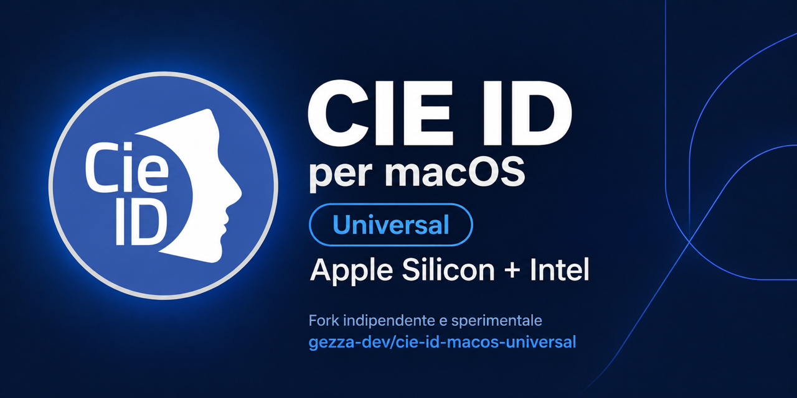
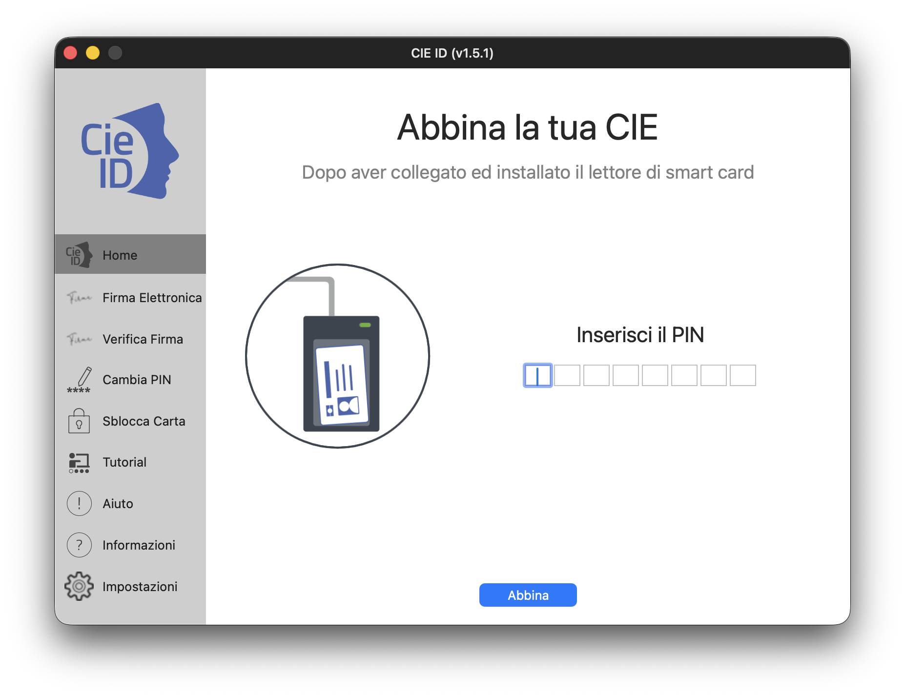
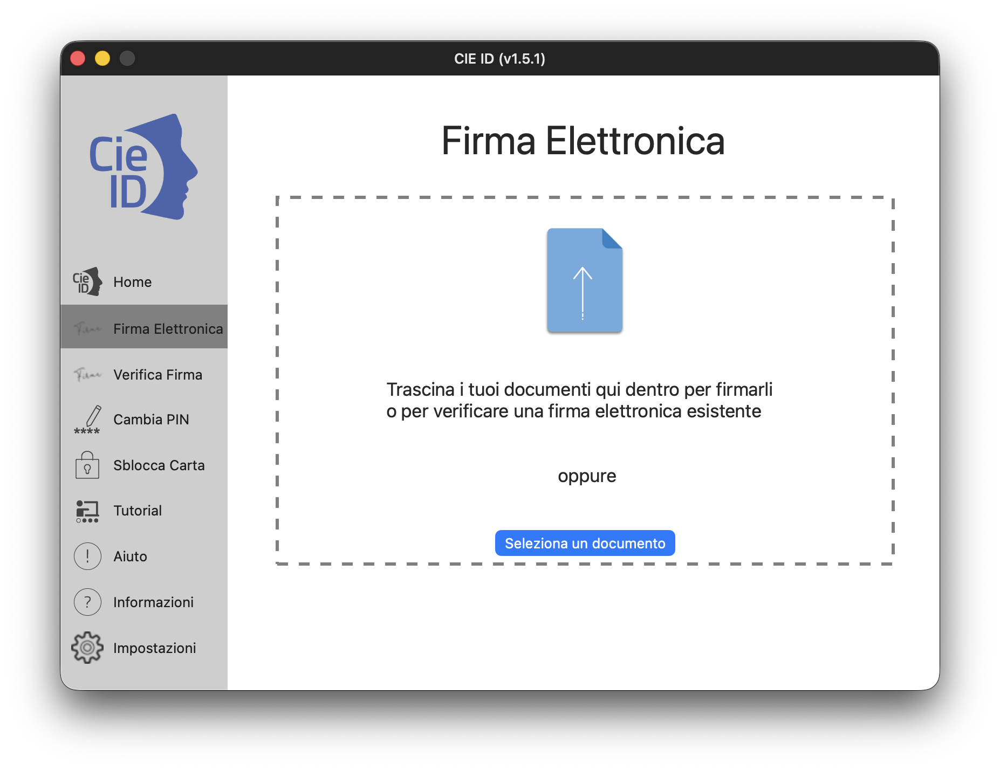
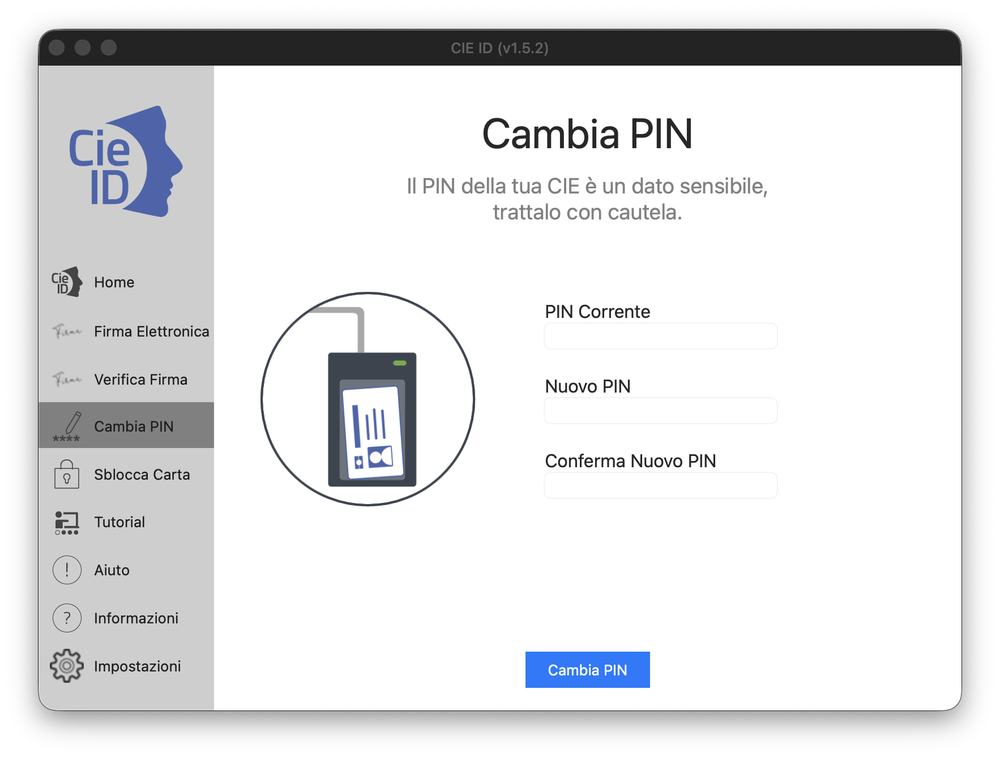
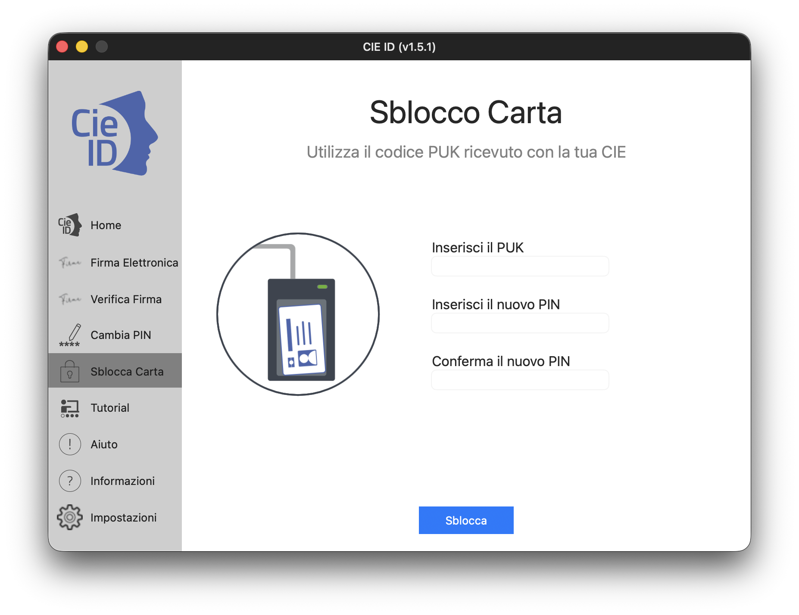

# CIE ID per macOS — Universal

Fork indipendente e sperimentale di
[italia/cie-middleware-macos](https://github.com/italia/cie-middleware-macos),
con app macOS, middleware PKCS#11, estensione CryptoTokenKit e SDK di firma
compilati nativamente per **Apple Silicon (arm64) e Intel (x86_64)** in
un unico bundle **Universal**.

**Questo fork non è un prodotto ufficiale dell'Istituto Poligrafico e Zecca dello Stato Italiano, non è approvato o
supportato da IPZS e non sostituisce la distribuzione ufficiale.** I nomi,
i copyright e gli avvisi del progetto originale sono conservati per
attribuzione. L'interfaccia conserva risorse e nomi storici: ciò non implica
un'autorizzazione all'uso promozionale dei marchi né un'approvazione del fork.

La documentazione ufficiale è disponibile su
[Docs Italia](https://docs.italia.it/italia/cie/cie-middleware-windows-docs/it/master/index.html)
e il prodotto ufficiale su
[Mac App Store](https://apps.apple.com/it/app/software-cie/id6476510798?mt=12).

## Scaricare CIE ID 1.5.1

La [release v1.5.1 (build 34)](https://github.com/gezza-dev/cie-id-macos-universal/releases/tag/v1.5.1)
contiene l'app Universal e i materiali corrispondenti:

- [DMG per installare CIE ID](https://github.com/gezza-dev/cie-id-macos-universal/releases/download/v1.5.1/CIE-ID-1.5.1-universal2.dmg),
  firmato con **Developer ID Application** e **notarizzato da Apple**.
- [Istruzioni di installazione in italiano](https://github.com/gezza-dev/cie-id-macos-universal/releases/download/v1.5.1/INSTALLAZIONE.txt),
  consultabili anche offline.
- [Sorgenti corrispondenti completi](https://github.com/gezza-dev/cie-id-macos-universal/releases/download/v1.5.1/CIE-ID-1.5.1-corresponding-source.tar.gz),
  inclusi gli archivi dei sorgenti delle 13 dipendenze e le ricette di build.
- [Checksum SHA-256](https://github.com/gezza-dev/cie-id-macos-universal/releases/download/v1.5.1/SHA256SUMS.txt)
  per verificare i tre allegati precedenti.

## Requisiti e installazione

- **macOS 12.0 o successivo**, su Mac Apple Silicon oppure Intel.
- Una **CIE e un lettore compatibile** per le operazioni sulla carta.
- L'accesso a Internet è necessario per interrogare i servizi di revoca
  durante la verifica delle firme.

1. Scaricare il [DMG della release v1.5.1](https://github.com/gezza-dev/cie-id-macos-universal/releases/download/v1.5.1/CIE-ID-1.5.1-universal2.dmg).
2. Chiudere eventuali copie di CIE ID in esecuzione e aprire il DMG.
3. Trascinare **CIE ID.app** sul collegamento **Applicazioni** presente
   nella finestra. Se esiste già un'app con lo stesso nome, verificare
   quale versione conservare prima di confermare una sostituzione.
4. Espellere il volume **CIE ID 1.5.1**.
5. Avviare **CIE ID** dalla cartella **Applicazioni** e seguire la procedura
   di associazione della carta.

Il fork utilizza identificativi e cache separati dall'app ufficiale: può
essere necessaria una nuova associazione della CIE. Se macOS richiede
l'attivazione dell'estensione per smart card, autorizzare **CIEToken**
nelle Impostazioni di Sistema. Non è necessario disattivare Gatekeeper.

Per verificare i download, salvare i quattro allegati della release nella
stessa cartella ed eseguire nel Terminale da quella cartella:

```sh
shasum -a 256 -c SHA256SUMS.txt
```

Ogni file deve riportare `OK`. Per ricompilare la versione distribuita,
usare l'archivio **corresponding-source.tar.gz**: i download automatici
GitHub **Source code (zip/tar.gz)** non includono gli archivi delle dipendenze.
Il tag `v1.5.1` identifica lo snapshot usato per quella release; il ramo
`main` può contenere aggiornamenti successivi, compresa questa documentazione.

## Stato del progetto

- Release **1.5.1 (build 34)** Universal disponibile per Apple Silicon e Intel.
- Compilazione e test software di entrambe le architetture verificati con
  Xcode 27 e macOS 26.7.1 su Apple Silicon; i test Intel sono eseguiti tramite
  Rosetta e non sostituiscono il collaudo su un Mac Intel reale.
- Dipendenze ricostruite dai sorgenti con versioni e SHA-256 fissati.
- App, middleware ed estensione della Release firmati con Developer ID
  Application; app e DMG notarizzati da Apple. Verificati Gatekeeper,
  ticket incorporati e integrità dell'app dopo la copia dal DMG.
- Firma Apple Development disponibile per le build di collaudo. Il
  riconoscimento della carta e i flussi hardware vanno verificati sui Mac,
  sulle CIE e sui lettori effettivamente utilizzati.
- RSAEURO, SHA-1 legacy e parti GPL dell'SDK sostituiti con adattatori
  OpenSSL e implementazioni BSD basate sulla libreria standard C++.
- Repository indipendente pubblicato da uno snapshot ripulito; la storia Git
  upstream precedente contiene ancora i componenti rimossi e non viene importata.
  La distribuzione binaria deve includere i sorgenti corrispondenti e
  rispettare i termini LGPL e delle altre dipendenze. Consultare
  [LICENSE_AUDIT.md](LICENSE_AUDIT.md) e [Docs/PUBLICATION.md](Docs/PUBLICATION.md).

## Funzioni e modifiche del fork

L'interfaccia dell'app e le finestre di apertura/salvataggio dei documenti
sono in italiano. Le funzioni disponibili comprendono:

- **Associazione e gestione delle CIE** nell'app.
- **Cambio PIN** e **sblocco della carta tramite PUK**.
- **Firma elettronica con CIE** in formato **PAdES** per i PDF e **CAdES**
  per i file `.p7m`, con anteprima e segno grafico opzionale per la firma PDF.
- **Verifica delle firme** di PDF e file `.p7m`, con dettagli dei firmatari,
  validità crittografica della firma, periodo di validità del certificato
  e stato di revoca presentati separatamente.
- **Estrazione del documento** contenuto nei file `.p7m`.
- **Integrazione smart card** tramite middleware **PKCS#11** ed estensione
  **CryptoTokenKit**, inclusi nel bundle per entrambe le architetture.
- **Impostazioni di proxy e log**, guida del fork inclusa nell'app e consultabile
  anche offline, con collegamenti esterni aperti nel browser predefinito, e aiuto integrato.

La verifica distingue uno stato di revoca sconosciuto o un servizio non
raggiungibile da una firma crittograficamente non valida.

Il progetto comprende un'app AppKit per la CIE, un middleware PKCS#11 v2.20
in sola lettura e un TokenDriver CryptoTokenKit per esporre il certificato
di autenticazione e la chiave privata presenti sulla carta.

Il porting introduce build riproducibili delle dipendenze ARM64, configurazione
Xcode centralizzata, collegamento statico di SSZipArchive senza CocoaPods e
caricamento del middleware da `Contents/Frameworks`. L'SDK usa un adattatore
per PoDoFo pubblico e aggiornamenti incrementali dei PDF già firmati. Gli
hash SHA-1/224/256 e il recupero di firme RSA usano OpenSSL; SHA-1 resta per
compatibilità con formati esistenti. La build usa OpenSSL **3.5.9 LTS**, con
supporto del ramo fino all'8 aprile 2030 ([fonte ufficiale](https://openssl-library.org/source/)).
I provider default e legacy sono incorporati negli archivi statici: non
servono moduli o configurazioni OpenSSL installati sul Mac. Le API ENGINE
restano come compatibilità dell'SDK; sono deprecate e la migrazione qui
non elimina tutte le API low-level usate dai protocolli della carta.
La grafica può differire dal fork PoDoFo originale; i dati grafometrici
privati senza sorgenti vengono rifiutati. Il porting non certifica i flussi
FEA né l'idoneità della build per uso produttivo.

## Screenshots

Alcune schermate di CIE ID **v1.5.1** su macOS.

**Home** — associazione della CIE tramite il PIN.



**Firma Elettronica** — selezione o trascinamento del documento da firmare.



**Cambia PIN** — modulo per aggiornare il PIN della CIE.



**Sblocca Carta** — sblocco della CIE tramite PUK e impostazione di un nuovo PIN.



## Licenze, attribuzioni e pubblicazione

[`LICENSE.txt`](LICENSE.txt) conserva senza modifiche la licenza BSD
3-Clause dell'upstream e il copyright IPZS. Le nuove parti originali del
fork seguono BSD 3-Clause; le modifiche a file con licenze specifiche
mantengono i rispettivi termini. Il repository contiene anche LGPL, GPL,
MPL 2.0, MIT, zlib e altre licenze: **non è interamente BSD**.

- [THIRD_PARTY_NOTICES.md](THIRD_PARTY_NOTICES.md): componenti, versioni,
  attribuzioni e collegamenti ai testi completi.
- [LICENSES/](LICENSES/): testi di licenza e avvisi riprodotti dalle fonti
  verificate, compreso il font Allura.
- [LICENSE_AUDIT.md](LICENSE_AUDIT.md): evidenze, obblighi e condizioni di distribuzione.
- [Docs/PUBLICATION.md](Docs/PUBLICATION.md): passaggi per il repository
  indipendente e per eventuali release successive.
- [scripts/license-manifest.json](scripts/license-manifest.json): provenienza
  dei testi, checksum e versioni confrontate con i lockfile.

Per controllare integrità e copertura degli avvisi:

```sh
python3 scripts/check-publication.py
```

`--publish` controlla lo snapshot dei sorgenti. Per abbinare una build ai
sorgenti completi delle dipendenze e alle ricette di ricompilazione:

```sh
python3 scripts/prepare-source-package.py --arch arm64
python3 scripts/check-publication.py --release --arch arm64
```

Il pacchetto va distribuito insieme all'app corrispondente. Qualsiasi
modifica ai sorgenti o al bundle invalida l'abbinamento: ripetere build e
preparazione. Le istruzioni per modificare e ricollegare le librerie LGPL
sono in [Docs/REBUILDING.md](Docs/REBUILDING.md). I controlli non sostituiscono
firma Apple, collaudo hardware o rispetto degli obblighi di distribuzione.

## Build

Per compilare l'app completa nativa per Apple Silicon, dalla radice del repository:

```sh
python3 scripts/build-native-app.py --arch arm64 --jobs 6
```

Servono Xcode completo con licenza accettata e componenti installati, Python
3.10+, CMake 3.23+, make, Perl, pkg-config, Meson 1.11+ e Ninja. La prima build richiede Internet.
Con Xcode 27 il deployment target minimo è macOS 12.0.


Lo script ricostruisce dipendenze statiche e SDK di firma, esegue i test CMake,
prepara gli archivi per Xcode, compila lo schema `CIE ID` e verifica tutti i
Mach-O e gli avvisi di licenza nel bundle e nell'estensione. CocoaPods non
è più necessario. Gli archivi Intel storici sono esclusi dallo snapshot del
fork; la loro rimozione non riscrive la storia Git. Se una build incrementale
mantiene risorse obsolete, ricompilare con `--clean`.

L'app verificata è accessibile da `dist/arm64/CIE ID.app`, visibile nel
Finder. Nei checkout sincronizzati tramite File Provider (per esempio iCloud
Documents), questo percorso è un collegamento simbolico al bundle locale
in `~/Developer/Builds/CIE-ID/arm64/CIE ID.app`.
File Provider ripristina infatti metadati Finder sui bundle nella cartella
sincronizzata, interferendo con la verifica rigorosa della firma Apple.
La copia locale conserva la firma e rimuove solo FinderInfo e ResourceFork;
la versione installata ufficiale non viene sostituita. Per confezionare un
archivio da distribuire usare il bundle reale, risolvendo il collegamento,
e non archiviare il solo link. Nei checkout non sincronizzati il bundle
resta direttamente in `dist`.
Middleware e `CIEToken.appex` contengono ciascuno la propria libreria ARM64 in
`Contents/Frameworks`. Il caricamento usa il percorso del bundle, senza
dipendere da una copia preesistente in `/Applications`. I target ausiliari
`AbilitaCIE`, `CambioPIN`, `SbloccoPIN` e `TestCIE` usano la stessa architettura.

Per preparare soltanto le dipendenze e poi lavorare nell'interfaccia Xcode:

```sh
python3 scripts/build-native-app.py --arch arm64 --prepare-only
open cie-pkcs11.xcodeproj
```

`Native.xcconfig` centralizza architettura, header, librerie e macro Crypto++.
La preparazione è necessaria prima di compilare direttamente da Xcode.

La build automatica predefinita verifica la compilazione senza firma. Per
la firma locale con Apple Development, copiare `LocalSigning.xcconfig.example`
in `LocalSigning.xcconfig` e impostare il Team ID del proprio certificato e
un bundle identifier del fork. Il file locale è escluso da Git e dai pacchetti
sorgente; non deve contenere password o chiavi private.

```sh
python3 scripts/build-native-app.py --arch arm64 --sign-development --configuration Debug
```

App e CTK usano rispettivamente `$(CIE_BUNDLE_ID)` e
`$(CIE_BUNDLE_ID).CIEToken`. Il gruppo macOS condiviso
`$(DEVELOPMENT_TEAM).$(CIE_BUNDLE_ID)` viene inserito negli entitlements,
nei due Info.plist e nel middleware; cache e log vengono risolti con
`NSFileManager`, senza riferimenti agli identificativi IPZS. Il prefisso
del team deve coincidere con il Team ID del certificato (campo OU, che può
essere diverso dal codice tra parentesi nel nome del certificato).
[Apple documenta](https://developer.apple.com/documentation/xcode/accessing-app-group-containers)
che questo formato di gruppo macOS non richiede un provisioning profile.
Altri servizi eventualmente aggiunti possono richiederlo.
La cache del fork è separata da quella della versione ufficiale: per il
collaudo con carta reale può essere necessaria una nuova associazione.

La configurazione locale è letta anche compilando da Xcode. Per lavorare
sull'app scegliere lo schema `CIE ID`; per il debug dell'estensione usare
lo schema `CIEToken` e selezionare il processo ospitante del fork.
`--team TEAM_ID` permette di sostituire il team dalla riga di comando.
Lo script controlla firma Apple Development, team di tutti gli eseguibili,
entitlements e corrispondenza del gruppo tra app ed estensione. Al primo
utilizzo il portachiavi può chiedere di autorizzare `codesign`: inserire
la password soltanto nella finestra di macOS.

La build firmata viene esportata in `dist/arm64/CIE ID.app`. Aprirla dal
Finder, senza sostituire l'app ufficiale. La firma Development serve al
collaudo locale; non equivale alla firma Developer ID o alla notarizzazione.
Il riconoscimento e l'attivazione effettiva CTK vanno verificati sul Mac.

### Bundle Universal per il collaudo

Per compilare ARM64 e Intel dallo stesso snapshot e ottenere un'unica app
firmata con Apple Development:

```sh
python3 scripts/build-universal-app.py --configuration Debug --jobs 6
python3 scripts/prepare-source-package.py --arch universal2
python3 scripts/check-publication.py --release --arch universal2
```

Il builder esegue i test di entrambe le architetture: su Apple Silicon serve
Rosetta per eseguire gli strumenti Intel. Il collaudo Intel su Rosetta non
sostituisce quello su un Mac Intel reale. Le build separate restano in
`dist/arm64` e `dist/x86_64`; il risultato completo è
`dist/universal2/CIE ID.app`. Nei checkout iCloud questo è un collegamento
al bundle reale `~/Developer/Builds/CIE-ID/universal2/CIE ID.app`.

Il builder usa `lipo` su tutti i Mach-O dell'app, compresi i componenti Debug,
`CIEToken.appex` e le due copie del middleware. Lo SDK di firma e le sue
dipendenze statiche sono incorporati in entrambe le architetture del
middleware; una copia Universal dello SDK viene preparata anche in
`.build/native/universal2/libcie_sign_sdk.a`.
Il confronto delle risorse rifiuta bundle incompatibili. I nib AppKit sono
indipendenti dalla CPU: per lo storyboard vengono usate insieme le risorse
ARM64, accettando UUID e ordine degli oggetti generati da ibtool solo quando
sorgenti e Xcode delle due ricevute coincidono. I contenuti e i digest delle
immagini nel catalogo devono coincidere, escluso il timestamp di compilazione.
Le firme vengono
rigenerate dall'interno verso l'esterno con lo stesso certificato Development,
conservando sandbox, App Group, smart card e permessi Debug. Ogni architettura
viene controllata per evitare dipendenze dinamiche da Homebrew o dal checkout.
I test PKCS#11 e PDF/CMS caricano le librerie effettivamente incorporate nel
bundle unito, sia in ARM64 sia in x86_64.

`--prepared-dependencies` riusa i prefissi già compilati e verificati.
`--merge-only` riusa anche le app separate, solo se le ricevute di build
corrispondono esattamente ai sorgenti correnti e ai bundle. Le modifiche
richiedono nuove build. `--team TEAM_ID` e `--configuration Release` sono
supportati. Per la distribuzione Developer ID usare la procedura Release seguente.
Il progetto Xcode continua a compilare un'architettura per volta attraverso
`CIE_NATIVE_ARCH`; per il bundle completo usare il builder Universal.

### Release Universal con Developer ID e notarizzazione

Compilare una Release con identificativi di distribuzione e un proprio
certificato Developer ID Application:

```sh
python3 scripts/build-universal-app.py --configuration Release --prepared-dependencies \
  --sign-developer-id --team YOURTEAMID --bundle-id com.example.CIEID \
  --signing-identity "Developer ID Application"
```

Omettere `--prepared-dependencies` per ricompilare anche le dipendenze.
Il builder abilita hardened runtime e timestamp sicuro, esclude il codice
Preview/Debug e controlla che app ed estensione abbiano la stessa versione
e numero di build. Tutti i componenti incorporati sono firmati con Developer ID.
Il risultato è `dist/release/universal2/CIE ID.app`; nei checkout iCloud il
bundle reale è `~/Developer/Builds/CIE-ID/release/universal2/CIE ID.app`.
Identificativi, App Group e cache della Release sono determinati dal
`--bundle-id`, separatamente da quelli della variante Development.

Configurare una sola volta il profilo del portachiavi, inserendo Apple
Account e password specifica per app esclusivamente nei prompt del Terminale:

```sh
xcrun notarytool store-credentials "CIE-ID-notary" --team-id YOURTEAMID
python3 scripts/notarize-release.py --profile CIE-ID-notary
```

Lo script invia il ZIP ad Apple, conserva l'ID della richiesta e attende fino
a 45 secondi. Se Apple sta ancora elaborando, termina con stato 75: ripetere
lo stesso comando per proseguire senza caricare una nuova richiesta.
Solo dopo `Accepted` applica e verifica il ticket con stapler, controlla
Gatekeeper e prepara lo ZIP finale, i sorgenti corrispondenti e SHA256SUMS
accanto al bundle reale. Lo ZIP finale viene anche estratto in una cartella
temporanea per verificare che firma e ticket siano presenti nel materiale
che riceverà l'utente. Non sono necessarie password nella riga di comando
né chiavi private nella directory del progetto.

I materiali non sono pronti per la distribuzione fino alla conclusione di
questi controlli. Le ricevute sono in `.build/publication/release`; il log
Apple viene conservato sia in caso di approvazione sia in caso di rifiuto.
Dopo modifiche a sorgenti, bundle o firma occorre una nuova build e una
nuova notarizzazione. Il pacchetto dei sorgenti deve accompagnare lo ZIP.

I test senza carta verificano il caricamento PKCS#11, Crypto++, firma CMS del
PDF, PNG trasparente e seconda firma incrementale. I test di verifica
esercitano anche il collegamento usato dall’interfaccia: nomi dei firmatari,
PDF/CMS validi e alterati, firme multiple, revoca sconosciuta e recupero
dopo errori di lettura. Periodo di validità del certificato e stato di revoca
sono riportati separatamente. I test automatici della build non eseguono
operazioni sulla carta: autenticazione, associazione, gestione PIN e firme
PAdES/CAdES richiedono anche un collaudo con lettore e CIE reali.

Versioni delle dipendenze, compatibilità OpenSSL e differenze del nuovo
adattatore PoDoFo sono documentate nel [README del SDK](cie_sign_sdk/README.md).
`build-native-app.py --arch x86_64` prepara la variante Intel separata;
`build-universal-app.py` prepara il bundle completo per entrambe le architetture.

### Correzioni di sicurezza della versione 1.5.1

La verifica di revoca controlla firma, autorizzazione del risponditore,
certificato richiesto e validità temporale delle risposte OCSP/CRL.
Le connessioni HTTPS verificano certificato e nome del server mediante il
trust store di macOS. Le dipendenze sono aggiornate, inclusa la migrazione
PDF a PoDoFo 1.1.2 LTS. I dettagli e i test sono in [Docs/SECURITY.md](Docs/SECURITY.md).
